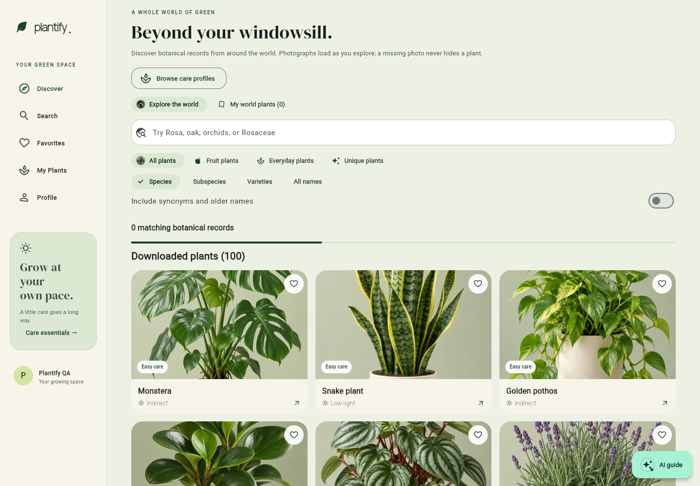
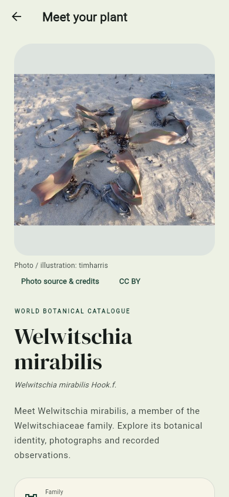
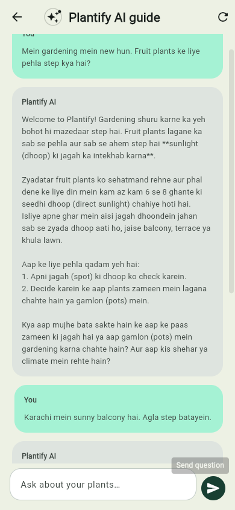

# Plantify

A Flutter app for discovering plants, learning their care needs, and keeping a personal garden.

[Open Plantify](https://plantify-00.web.app) · [Download Android APK](https://github.com/Muhammad-Dani-yal/Plantify/raw/refs/heads/main/Plantify.apk) · [Build notes](docs/BUILD.md)

## Features

- 100 photographed care profiles, plus live worldwide botanical search powered by GBIF.
- Downloaded plants appear first; online results load automatically while scrolling.
- Fruit, everyday and unique plant collections, search filters, plant matching and comparison.
- Real email/password authentication, password reset and email verification requests.
- Private favourites, garden notes and watering records synced through Firestore.
- An AI gardening guide with plant context, follow-up questions and Roman Urdu support.
- Responsive layouts, animated botanical controls, welcome slides and dark mode.

## Screens

| Discover | Plant profile | AI guide |
| --- | --- | --- |
|  |  |  |

## Tech stack

Flutter / Dart · Firebase Authentication · Cloud Firestore · Firebase AI Logic · GBIF · Firebase Hosting.

## Firebase

Android and Web are configured for the same Firebase project. Owner-only Firestore rules protect each account's favourites, garden and world-plant bookmarks. Passwords are handled by Firebase Authentication.

App Check integration supports Android Play Integrity and Web reCAPTCHA v3, including attestation headers for AI requests. It is opt-in until providers and valid attestation are configured; production enforcement is not enabled. See [release setup](docs/RELEASE.md).

## AI

The guide makes authenticated requests to Firebase AI Logic. No Gemini secret is bundled. Conversations remain in memory, clear when leaving the guide or changing accounts, and support retry. Model availability and provider quotas apply.

## Setup

Use Flutter 3.32.6 or compatible newer tooling, Dart 3.6+, and JDK 17 for Android.

```sh
flutter pub get
flutter run -d chrome
flutter analyze
flutter test
flutter build web
```

Firebase app configuration is in `lib/firebase_options.dart` and `android/app/google-services.json`. To use your own project, register Android/Web apps, enable Email/Password authentication, supply app configuration and deploy the owner-only Firestore rules.

Validation: clean Flutter analysis, 48 passing tests, and live browser checks for authentication, favourites, garden notes/watering, logout/login restoration and real multi-turn AI answers. Real-inbox email delivery remains a manual check.

Android build instructions, asset optimisation and Windows troubleshooting are in [BUILD.md](docs/BUILD.md). Deployment, signing and App Check steps are in [RELEASE.md](docs/RELEASE.md).

## Architecture

The entry point is `lib/main.dart`. Screens and shared components use centralized application state management through `AppState extends ChangeNotifier` and an inherited application scope, `AppScope`. Services handle authentication, cloud persistence, catalogue search, photo resolution and AI requests; data models remain separate from widgets.

## Limitations

- Firebase support is configured for Android and Web; iOS/macOS are not configured.
- The portfolio APK is ARM64 and retains demo signing until the owner supplies a release keystore. Production signing configuration is available.
- App Check provider registration and enforcement remain production setup tasks.
- Worldwide records are taxonomic data, not a guarantee of every plant or cultivar. Photographs and verified care guidance are unavailable for some records.
- Internet access is required for authentication, cloud sync, worldwide discovery and AI.
- Email delivery/verification-link completion require a real inbox and have not been confirmed by automated QA.

The complete version 1.0.2 ARM64 APK is approximately 15.46 MB. All 100 curated photos and the welcome image are bundled as WebP. Photo attribution is preserved in plant profiles and [credits](assets/catalogue/credits.json). Care guidance is a starting point and must be adapted to local conditions.
